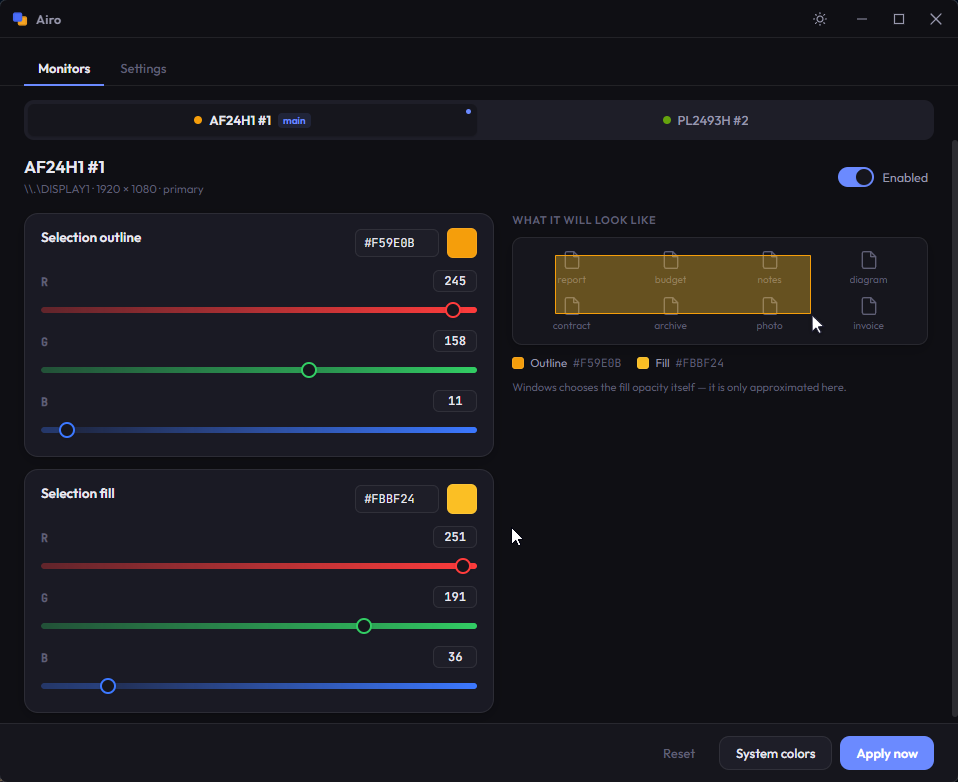
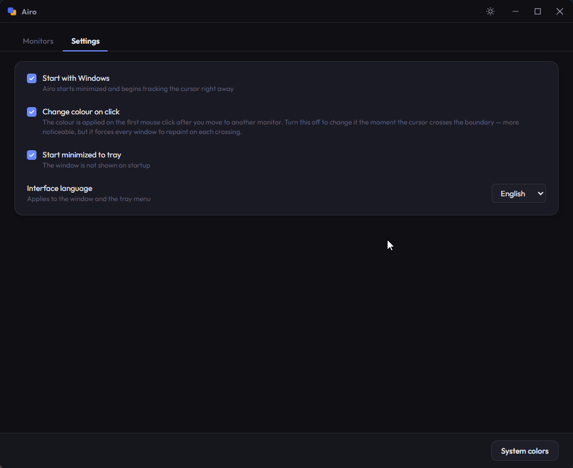

<div align="center">


# Airo

**Per-monitor selection colors for Windows.**
Give every display its own highlight color — Airo switches it automatically as your cursor moves between screens.

English · [Русский](README.ru.md)

[](https://github.com/Toveal/airo/releases)
[](https://github.com/Toveal/airo/releases)


[](LICENSE)

</div>

<!--
  DEMO. The <video> tag streams the committed MP4 from its raw URL on the `main`
  branch — push docs/demo.mp4 there for it to resolve. If a viewer's setup ever
  fails to show the player, the fallback link below still opens the clip.
  Most reliable alternative: open this README in the github.com editor and drag
  docs/demo.mp4 into it — GitHub inserts a user-attachments URL that always embeds.
-->
<div align="center">

<video src="https://github.com/Toveal/airo/raw/main/docs/demo.mp4" width="760" autoplay loop muted playsinline controls></video>

[▶ Watch the demo](https://github.com/Toveal/airo/raw/main/docs/demo.mp4)

<sub><i>Each monitor gets its own highlight color — Airo switches it as the cursor moves.</i></sub>

</div>

## What it does

Windows paints the selection rectangle — the box you drag across the desktop or in Explorer — with a single color on every display. Airo lets you set a **different color for each monitor** and applies it automatically the moment your cursor crosses onto another screen. It lives quietly in the system tray and starts with Windows.

## Features

- 🎨 **A color per monitor** — outline and fill, tuned independently for each display
- 🖱️ **Automatic switching** — follows the cursor across monitors in real time
- 🌗 **Light & dark theme** — matches how you work
- 🌐 **English & Русский** — window and tray menu both localized
- 🚀 **Autostart & tray** — launches minimized, keeps out of the way
- ⬇️ **Auto-update** — checks GitHub Releases and updates in one click
- 🔒 **No admin required** — per-user install, no UAC prompt

## Screenshots

<table align="center">
  <tr>
    <td width="50%" valign="top">
      <br/>
      <sub><i>Per-monitor outline &amp; fill colors, with a live preview.</i></sub>
    </td>
    <td width="50%" valign="top">
      <br/>
      <sub><i>Autostart, start minimized, cursor behavior and language.</i></sub>
    </td>
  </tr>
</table>

## Installation

1. Download **`Airo_x.y.z_x64-setup.exe`** from the [latest release](https://github.com/Toveal/airo/releases/latest).
2. Run it. The installer is **per-user** — it installs to `%LOCALAPPDATA%\Airo` with no administrator prompt.
3. On first launch Windows SmartScreen may warn about an unknown publisher (the app isn't code-signed with a paid certificate). Click **More info → Run anyway**.

## Usage

1. Pick a monitor tab and set its **outline** and **fill** colors.
2. Close the window — it tucks into the tray and keeps running.
3. Move your cursor between displays; the selection color follows.

Everything saves as you go. Open **Settings** to toggle autostart, start-minimized, change-on-click, and the interface language.

## Updating

Airo checks GitHub Releases on startup. When a newer version is available, a banner appears at the bottom of the window with **Download and install** — one click updates and restarts the app.

## Build from source

**Requirements:** [Rust](https://www.rust-lang.org/tools/install) (stable) · [Bun](https://bun.sh) · Windows 10/11

```bash
bun install
bun run tauri dev      # run in development
bun run tauri build    # produce the installer
```

> **Note.** A release build signs the updater artifact, so `tauri build` needs the updater signing key in the environment:
>
> ```powershell
> $env:TAURI_SIGNING_PRIVATE_KEY = "<your private key>"
> $env:TAURI_SIGNING_PRIVATE_KEY_PASSWORD = ""
> bun run tauri build
> ```
>
> `bun run tauri dev` needs none of this.

**Stack:** Rust · Tauri 2 · Vue 3 · Vite

## License

Released under the [MIT License](LICENSE) © 2026 Toveal.
