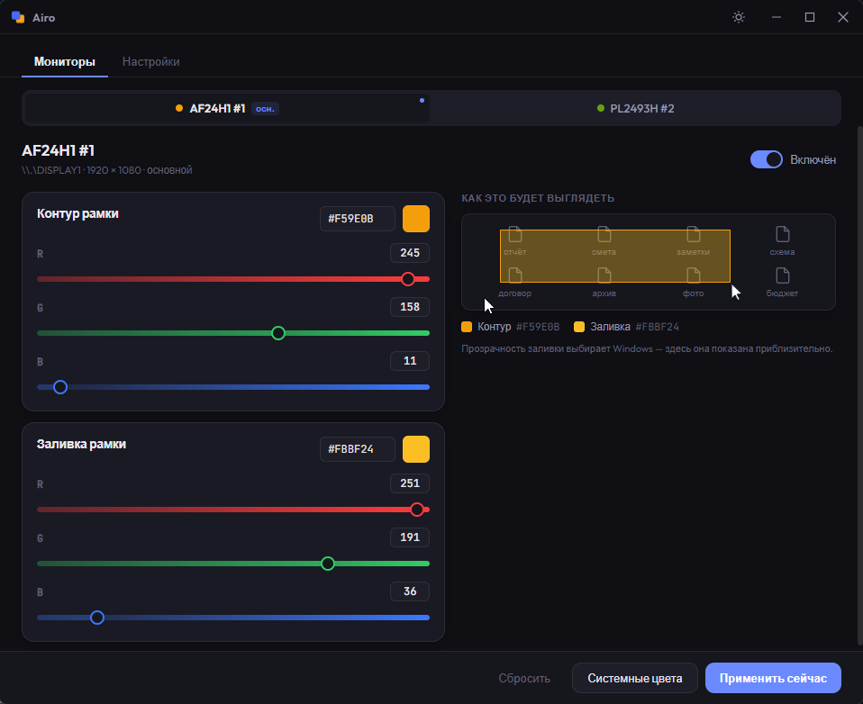
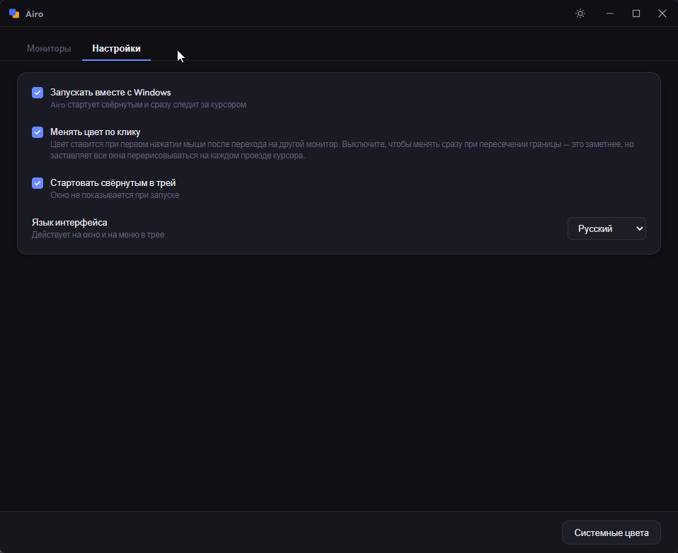

<div align="center">


# Airo

**Цвет выделения Windows меняется вслед за курсором между мониторами.**
Задайте каждому экрану собственный цвет — Airo переключает его сам, когда курсор переходит на другой монитор.

**v0.1.0 · Ранний выпуск** — будем рады отзывам и сообщениям об ошибках.

[English](README.md) · Русский

[](https://github.com/Toveal/airo/releases)
[](https://github.com/Toveal/airo/releases)


[](LICENSE)

</div>

<div align="center">


[▶ Смотреть демо](docs/demo.mp4)

<sub><i>Свой цвет выделения на каждом мониторе — Airo переключает его вслед за курсором.</i></sub>

</div>

## Что это

Windows красит рамку выделения — ту, что вы тянете мышью по рабочему столу или в проводнике — одним цветом на всех экранах. Airo позволяет задать **свой цвет для каждого монитора** и применяет его при переходе курсора на этот экран или по первому клику после перехода. Работает в трее и поддерживает необязательный автозапуск.

Цвета меняются **глобально для сеанса Windows**, вслед за курсором или по первому клику — в зависимости от настройки. Разные цвета не отображаются одновременно на разных экранах. Airo можно использовать и с одним монитором.

## Возможности

- 🎨 **Цвет на каждый монитор** — контур и заливка, отдельно для каждого экрана
- 🖱️ **Авто-переключение** — следует за курсором между мониторами в реальном времени
- 🌗 **Светлая и тёмная тема**
- 🌐 **English и Русский** — и окно, и меню в трее
- 🚀 **Автозапуск и трей** — стартует свёрнутым, не мешает
- ⬇️ **Авто-обновление** — встроенная поддержка подписанных обновлений из GitHub Releases
- 🔒 **Без прав администратора** — установка per-user, без запроса UAC

## Скриншоты

<table align="center">
  <tr>
    <td width="50%" valign="top">
      <br/>
      <sub><i>Цвета контура и заливки для каждого монитора, с живым превью.</i></sub>
    </td>
    <td width="50%" valign="top">
      <br/>
      <sub><i>Автозапуск, старт свёрнутым, поведение курсора и язык.</i></sub>
    </td>
  </tr>
</table>

## Установка

1. Скачайте **`Airo_0.1.0_x64-setup.exe`** из [последнего релиза](https://github.com/Toveal/airo/releases/latest).
2. Запустите. Установщик **per-user** — ставит в `%LOCALAPPDATA%\Airo` без запроса прав администратора.
3. При первом запуске Windows SmartScreen может предупредить о неизвестном издателе (приложение не подписано платным сертификатом). Нажмите **Подробнее → Выполнить в любом случае**.

Нужны **Windows 10/11 x64** и Microsoft Edge WebView2 Runtime. Если WebView2 отсутствует, установщик может скачать его; для этого понадобится интернет. Совместимость с разными сборками Windows ещё проверяется.

## Как пользоваться

1. Выберите вкладку монитора и задайте цвета **контура** и **заливки**.
2. Закройте окно — оно свернётся в трей и продолжит работать.
3. Двигайте курсор между экранами. По умолчанию цвета меняются по первому клику после перехода на другой монитор; это можно изменить в настройках.

Всё сохраняется на лету. В **Настройках** — автозапуск, старт свёрнутым, смена цвета по клику и язык интерфейса.

Чтобы остановить Airo и вернуть исходные цвета, выберите **«Выход»** в меню трея. Перед удалением приложения завершите его работу.

## Известные ограничения

- Основной эффект — рамка выделения на рабочем столе и в проводнике. Оформление выбранных файлов в проводнике не меняется; классические приложения Windows также могут использовать системные цвета, которые меняет Airo.
- Прозрачность заливки задаёт Windows. Предпросмотр приблизительный.
- После сбоя или принудительного завершения цвета могут остаться изменёнными. Запустите Airo повторно и завершите его через меню трея.
- Избегайте одновременного запуска нескольких копий Airo и других утилит, меняющих те же системные цвета.

## Обновления

Airo проверяет ленту обновлений GitHub Releases при запуске. Новое подписанное обновление можно установить через баннер в приложении. Для первого выпуска обновление между двумя публичными версиями ещё не проверено; установщик всегда можно скачать вручную. Недоступность ленты обновлений не мешает работе приложения.

## Сборка из исходников

**Требования:** Visual Studio C++ Build Tools с Windows SDK · WebView2 Runtime · [Rust](https://www.rust-lang.org/tools/install) (stable, MSVC) · [Bun](https://bun.sh) 1.4.2 · Windows 10/11 x64

```bash
bun install --frozen-lockfile
bun run tauri dev      # запуск в разработке
bun run tauri build --config src-tauri/tauri.local.conf.json -- --locked
```

Локальная конфигурация собирает тестовый установщик без приватного ключа подписи обновлений. Для релизной сборки используется обычная конфигурация и приватный ключ, соответствующий публичному ключу обновлений. Проверки и workflow создания черновика описаны в [инструкции выпуска](docs/RELEASING.md). Подпись обновлений не заменяет сертификат издателя Windows.

**Стек:** Rust · Tauri 2 · Vue 3 · Vite

## Обратная связь

[Сообщите об ошибке или предложите улучшение](https://github.com/Toveal/airo/issues). Укажите версию Airo, сборку Windows (`winver`), конфигурацию мониторов и шаги воспроизведения. Можно писать по-русски или по-английски.

## Лицензия

Распространяется под [лицензией MIT](LICENSE) © 2026 Toveal.
